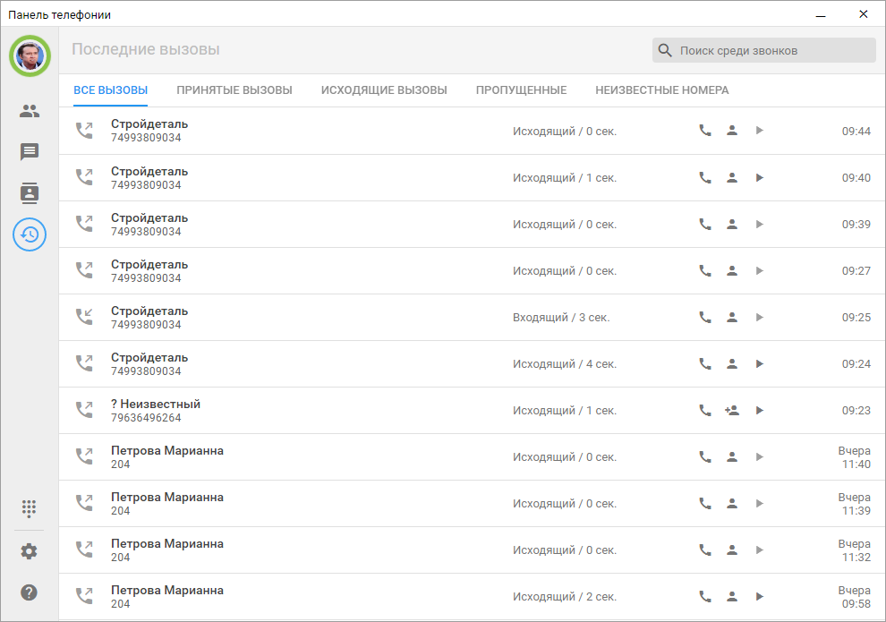

# История вызовов с записями разговоров

Во вкладке **Последние вызовы** отображаются входящие, исходящие и пропущенные звонки. Для каждого вызова показываются номер абонента, тип звонка, дата и время, а также длительность разговора.

Повторные пропущенные вызовы от одного номера группируются, чтобы список оставался компактным и удобным для просмотра.

Из истории вызовов можно сразу выполнить основные действия:
- перезвонить клиенту,
- открыть существующую карточку клиента в 1С или создать новую,
- прослушать запись разговора.

## Записи разговоров

Если есть запись разговора, она загружается из АТС и становится доступна прямо в истории вызовов.

Прослушивание выполняется во встроенном плеере: запись можно запустить или поставить на паузу без перехода на отдельную страницу.
