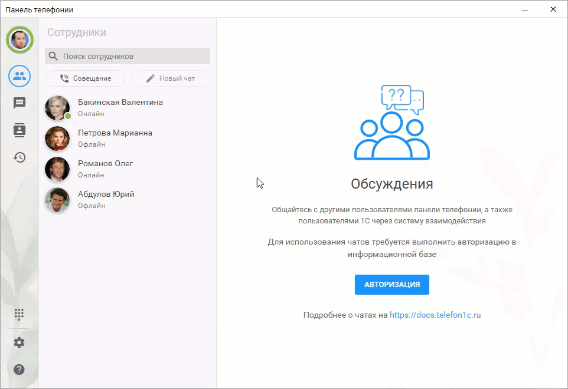
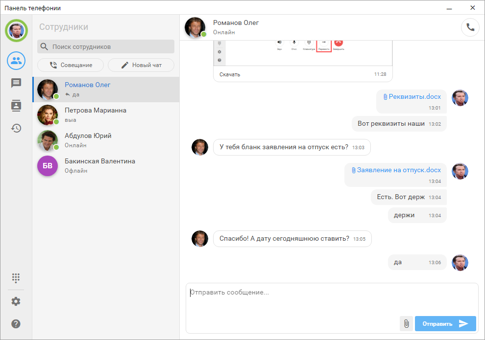

# Обсуждения с коллегами

Функционал обсуждений позволяет переписываться с коллегами в личных и групповых чатах, обмениваться файлами и изображениями, а также вести рабочую коммуникацию прямо во внешней панели или в 1С:Предприятии.

!!!
**Предварительная настройка информационной базы**

Для работы чатов необходимо предварительно настроить информационную базу:
1. <a href='/get-started/nastroyka_1c/#зарегистрируйтесь-в-системе-взаимодействия'>Зарегистрировать информационную базу</a> в системе взаимодействия.
2. <a href='/faq/base-publishing'>Настроить публикацию</a> информационной базы на веб-сервере.
3. <a href='/get-started/whatsapp/#смена-способа-соединения-с-long-polling-на-веб-сервис'>Установить режим соединения 1С</a> с АТС через веб-сервис.
!!!

Перед началом работы необходимо авторизоваться в чатах. После авторизации пользователь получает доступ к перепискам с коллегами и может отправлять сообщения, файлы и изображения.

В чатах доступны основные действия с сообщениями:
- отправка текста, файлов и изображений,
- использование эмодзи,
- цитирование сообщений,
- редактирование сообщений,
- удаление отправленных сообщений.

Также можно упоминать сотрудников, чтобы привлечь их внимание к конкретному сообщению или вопросу.

 
