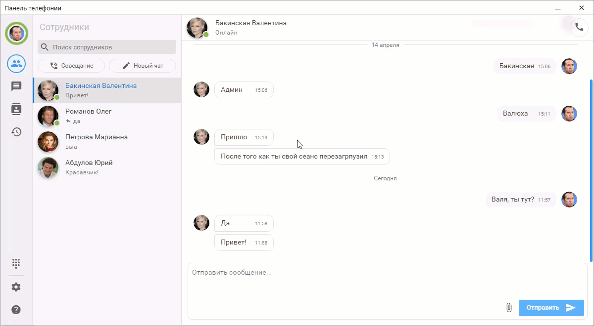
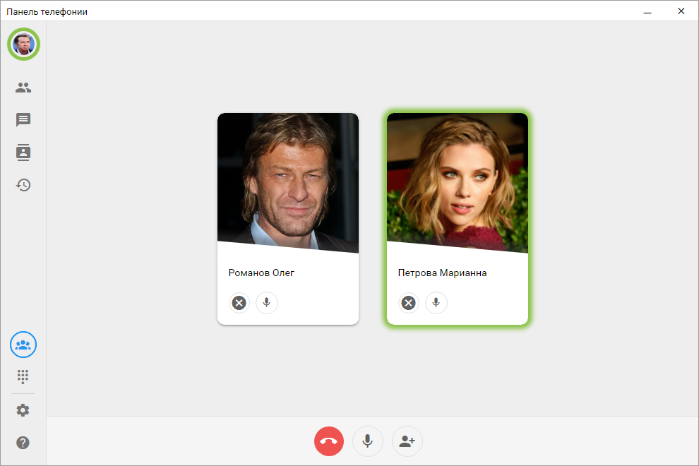

# Конференц-вызов

Конференц-вызов позволяет создать групповое совещание с несколькими сотрудниками. Конференции можно создавать только с внутренними сотрудниками. Внешних абонентов пригласить в конференцию нельзя.

Пользователь может создать конференцию и пригласить в нее одного или нескольких участников. После создания конференции приглашенные пользователи получают уведомление с возможностью принять или отклонить участие.

Участников можно пригласить как при создании конференции, так и во время уже активного конференц-вызова. Новый участник получает приглашение и подключается к конференции после его принятия.

Во время конференции доступен список всех подключенных участников. В зависимости от прав пользователя можно выполнять следующие действия:
- добавить участника;
- отключить участника от конференции;
- включить или отключить микрофон участника или свой микрофон.
