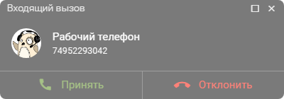
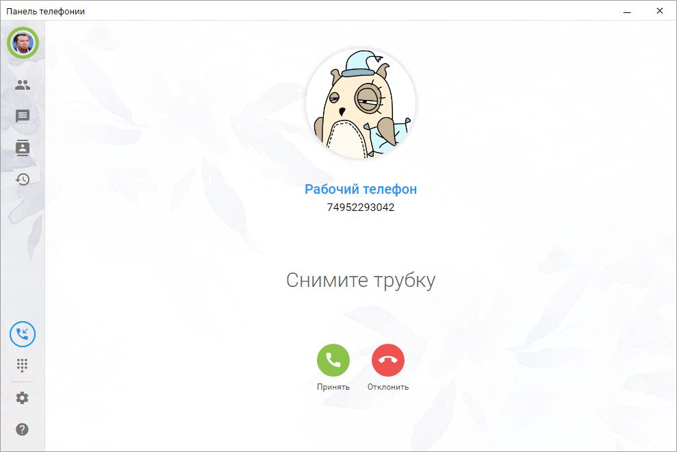
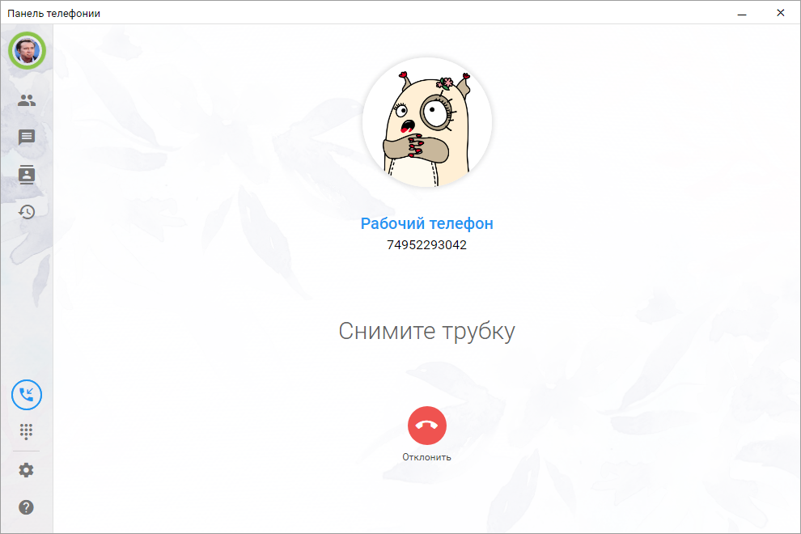
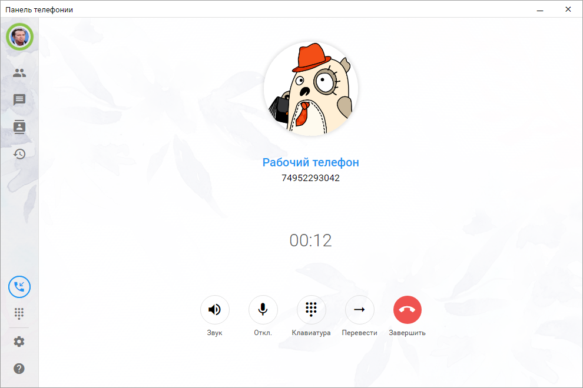
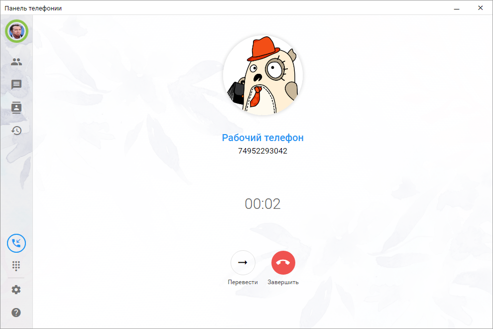

# Входящий звонок
При поступлении входящего звонка появляется звуковое уведомление и баннер с основными данными вызова.

## Поступление входящего вызова
Cистема автоматически определяет клиента по номеру телефона и показывает связанную информацию:
- компанию,
- контактное лицо,
- номер звонящего.
- 
При поступлении звонка отображается название звонящего клиента, если он найден в информационной базе, или номер абонента, если такого клиента в базе нет.

Если внешняя панель работает в режиме софтфона, в баннере доступны две кнопки: **Принять** и **Отклонить**. Если используется режим настольного телефона, доступна только кнопка **Отклонить**.

Во время входящего звонка в левой части окна программы появляется оранжевая кнопка. При нажатии на нее выполняется переход к окну активного звонка. В окне активного звонка отображаются доступные действия: в режиме софтфона — **Принять** и **Отклонить**, в режиме настольного телефона — **Отклонить**.

 

## Прием входящего звонка
После принятия вызова в режиме софтфона в блоке активного звонка отображается индикатор качества соединения и индикатор защищенного SRTP-звонка.

Пользователю доступны следующие действия:
- управление громкостью,
- включение и отключение микрофона,
- открытие DTMF-клавиатуры для тонального набора,
- постановка вызова на удержание и возврат с удержания,
- перевод вызова,
- завершение разговора.

 

После принятия вызова в режиме настольного телефона доступны:
- перевод вызова,
- завершение разговора.

Пользователь также может скопировать номер телефона.

 

## Поступление второго звонка
Если во время активного разговора поступает второй входящий звонок, в окне активного звонка появится информация о новом вызове.

Пользователь может выбрать одно из доступных действий: поставить текущий разговор на удержание и ответить на новый звонок, завершить текущий разговор и принять новый вызов либо отклонить второй входящий звонок. После завершения нового разговора можно вернуться к удержанному вызову и продолжить общение.
