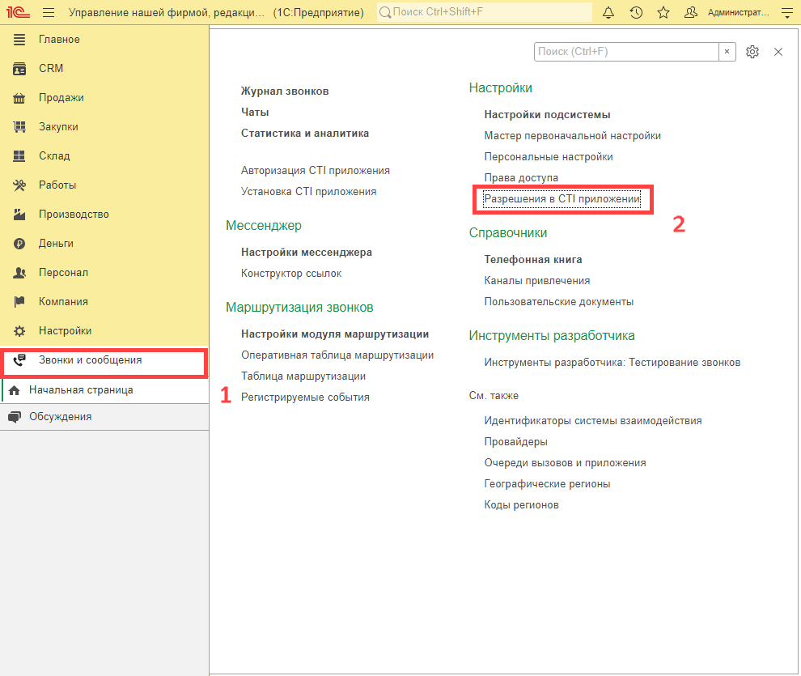
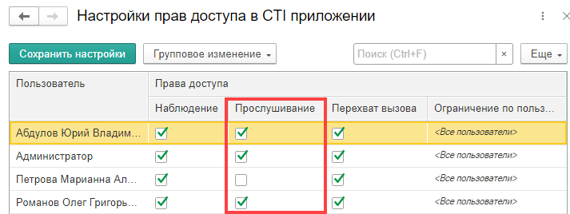
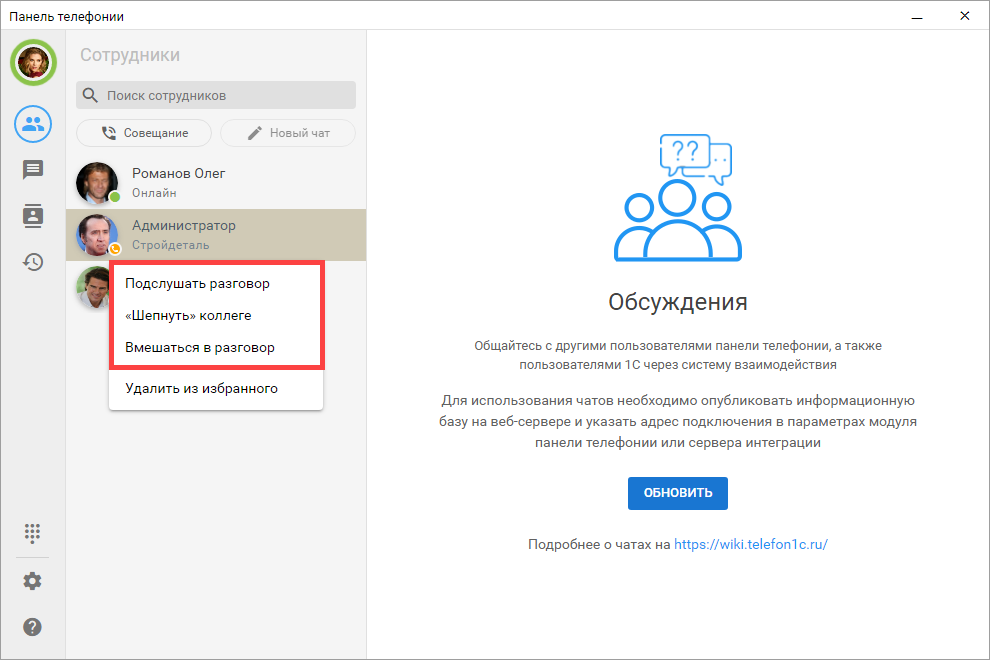
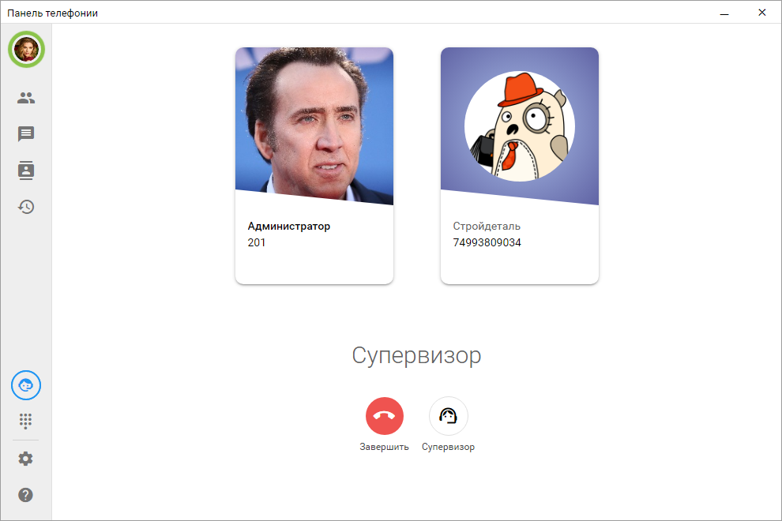
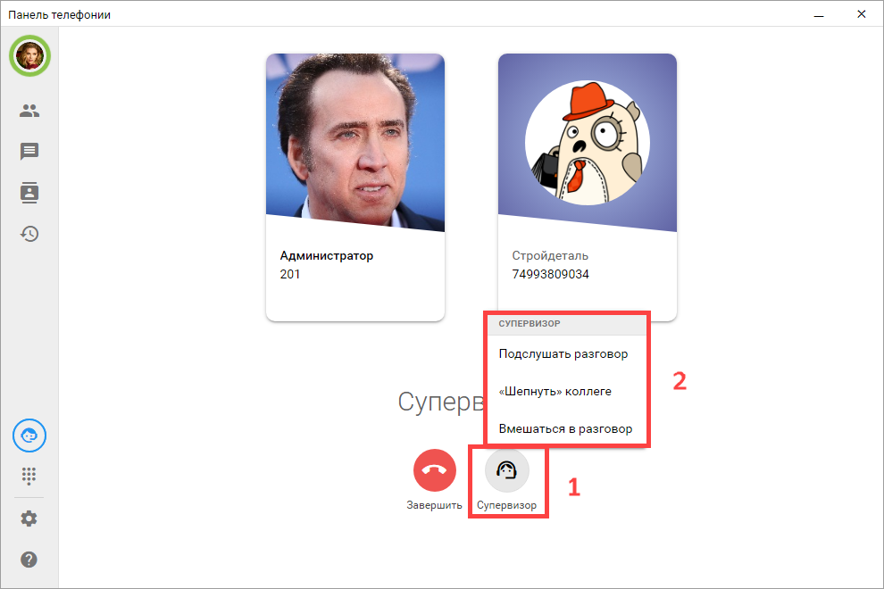

# Супервизор

Настройка функций супервизора для сотрудников выполняется в 1С.

Функция супервизора позволяет подключаться к активному разговору сотрудника в одном из режимов: прослушать, шепнуть или присоединиться к разговору.

Функция супервизора применяется только к сотруднику, то есть к внутреннему номеру.

Во время активного звонка коллеги супервизор выбирает сотрудника из списка Сотрудники и подключается к его разговору в нужном режиме.

Во время активного подключения можно изменить режим супервизора. Для этого нажмите кнопку **Супервизор** и выберите другую функцию.

Чтобы отключиться от прослушиваемого или совместного разговора, нажмите кнопку **Завершить**.

## Режимы супервизора

Во внешней панели доступны следующие режимы:

**Подслушать**  
Вы слышите разговор сотрудника с другим абонентом, но не участвуете в нем. Участники разговора вас не слышат. Режим используется для контроля качества, обучения и оценки работы оператора.

**Шепнуть**  
Вы слышите разговор и может говорить с сотрудником, при этом клиент не слышит вас. Режим удобен, когда оператору нужна помощь во время сложного звонка: например, подсказка по скрипту, условиям сделки или дальнейшим действиям.

**Присоединиться к разговору**  
Вы подключаетесь к разговору как полноценный участник. Вас слышат и сотрудник, и клиент. Этот режим используется, когда необходимо быстро взять ситуацию под контроль, помочь в спорном вопросе или продолжить разговор вместе с оператором.
