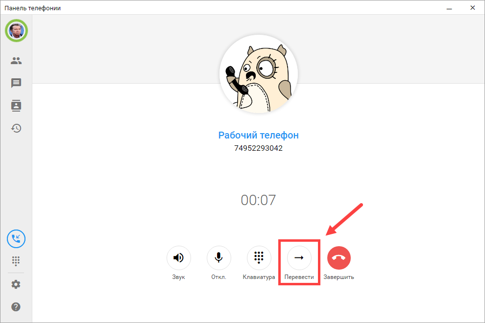
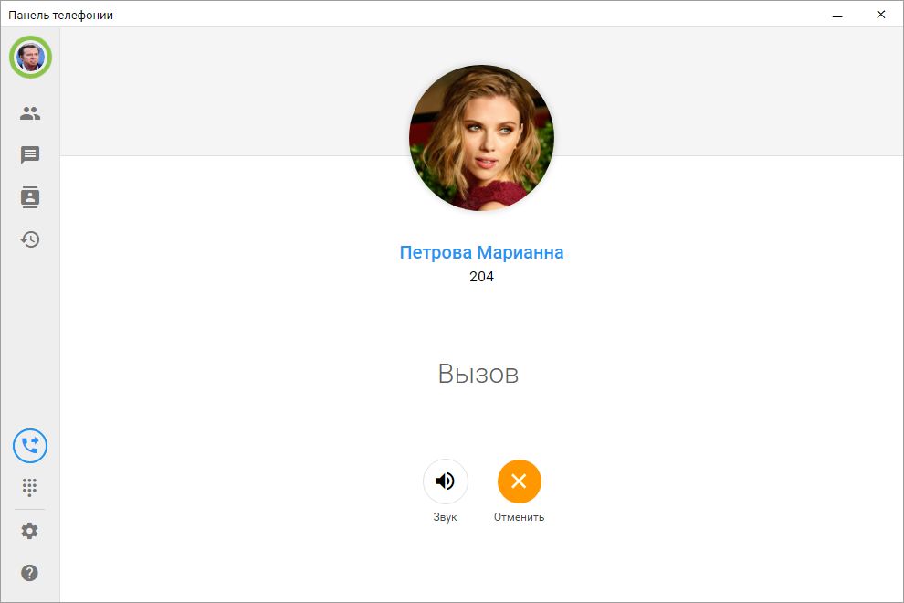
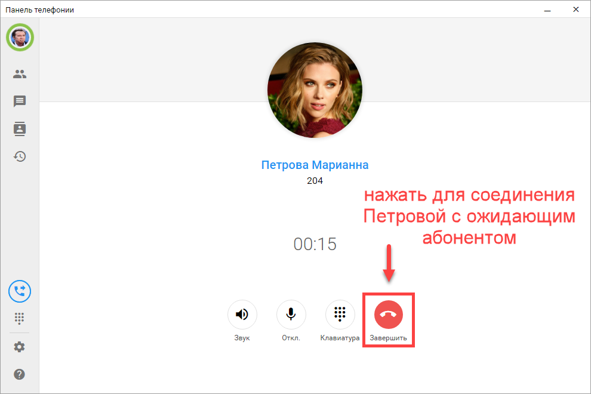
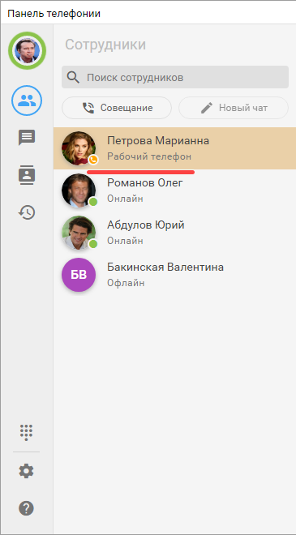

# Перевод звонка
Перевести звонок можно во время разговора в блоке активного звонка:
- Во время разговора нажмите кнопку Перевод. В открывшемся списке выберите сотрудника, которому нужно передать звонок. Для удобства можно воспользоваться строкой поиска.
  
  

- Также звонок можно перевести на ответственного сотрудника, если он назначен в карточке клиента в 1С.

Перевести звонок можно на вкладке Сотрудники. Для этого во время активного разговора откройте вкладку Сотрудники и нажмите кнопку Перевод в строке нужного сотрудника.

После выбора сотрудника начнется вызов от вас к выбранному сотруднику, а абонент, с которым вы разговаривали, будет поставлен на удержание.

Если используется **перевод с консультацией**, после ответа сотрудника начнется разговор между вами и ним. Вы сможете ввести его в курс дела, например объяснить, по какому вопросу звонит клиент.

 
Когда вы завершите звонок, клиент, находившийся на удержании, соединится с выбранным сотрудником.

Если используется **слепой перевод (без консультации)**, звонок сразу передается выбранному сотруднику без предварительного разговора с ним.

Убедиться, что перевод выполнен, можно на вкладке Сотрудники. У сотрудника, на которого был переведен звонок, появится индикатор занятости, а под его именем будет отображаться статус “Разговаривает” или название клиента, с которым он сейчас разговаривает.

Отображение информации зависит от того, какие разрешения на действия во внешней панели настроены пользователю в 1С.

!!! В режиме "Настольный телефон"
Когда внешняя панель работает в режиме настольного телефона, перевод выполняется аналогичным образом.
!!!